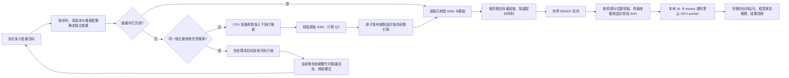

# MSA 搜索、链复用与原始对齐质控

蛋白结构预测的 CPU 准备需要单独观察。当前 AF3 准备进程运行数据库搜索及模板搜索，产出内嵌 MSA 和模板的 `*_data.json`；GPU worker 接收该制品后再完成特征化与预测。准备队列耗时长时，应先区分新链搜索、链缓存等待、资源等待、库读取和模板处理，才能决定增加哪一种资源。[AF3 v3.0.4 分阶段与性能说明](https://github.com/google-deepmind/alphafold3/blob/v3.0.4/docs/performance.md)

本页对应 `backend/msa_metrics.py` 的 QC v1。模块在单遍检查原始 A3M 时计算摘要，不改变序列、header、行次序、小写插入或重复记录。它为诊断提供结果证据；搜索提速仍来自独立链复用、合适的搜索并发与数据库 I/O。

## MSA 怎样持续给本地和云端 GPU 供料



当前控制器的 CPU 准备在本机线程和子进程中执行；上图中的阿里云执行位置沿用既有 GPU worker 协议。它不表示已经把 CPU 搜索实现成跨机器分布式 MSA 服务。真实部署继续搁置。

假设筛选由固定靶标 A 与十万个**不同**候选 B 组成，所有链均无缓存且配置相同：每个整目标都需要预测，但独立链搜索是 A 一次，加十万个 B 各一次。后续只改随机种子或采样数时，可以复用原有链准备结果。相同蛋白在不同链 ID 出现也可复用；换数据库版本、搜索或模板参数时重新形成身份。官方也把先准备单链、再组合目标作为阶段拆分的用途。[官方单链组合示例](https://github.com/google-deepmind/alphafold3/blob/v3.0.4/docs/performance.md#running-the-pipeline-in-stages)

本轮解决的是共享依赖引起的准备槽位空等：例如 worker 1 搜索 A，worker 2 的目标也是 A+B₂。worker 2 遇到 A 繁忙时先搜索 B₂；如果只剩 A，就保存已完成链的引用、暂缓该目标并释放资源，随后可领取 B₃ 或其他独立任务。暂缓不是搜索失败，界面分别显示 `searching`、`waiting_shared`、`assembling`。一次准备 worker 同时仍只启动一个搜索子进程，不能绕过 CPU/内存/磁盘预算增加实际搜索并发。

若预算只容纳一个搜索进程，上述改动不会凭空增加并行算力。它在已有可用准备容量被共享链等待占住时消除空等；搜索本身慢、数据库读取慢或全部候选都不同，仍需要对应资源和算法优化。没有真实库测试，不给出固定提速百分比。

## 判断该增加 CPU、I/O 还是 GPU

先看 READY 队列、当前搜索/共享等待数、独立链新搜索与命中数，再看真实机器上的 CPU、内存、磁盘读取和 GPU 忙闲。界面的预算预留是调度估计，不是这些操作系统测量值。

| 观测组合 | 工程动作与验收 |
|---|---|
| READY 经常为空，GPU 等待；新链搜索很多 | 检查 CPU 搜索产出率。逐档增加准备并发，在真实代表性序列上比较每小时准备完成目标数；同时测内存和库读取，避免只增加线程数。 |
| 多个目标等待相同链，仍有独立候选可做 | 检查暂缓与让出槽位是否生效；搜索日志应显示独立链继续完成，共享链只有一个搜索生产者。 |
| 搜索并发增加后单链更慢、磁盘读取饱和 | 检查本地数据库读取路径、热点库、存储带宽和可用内存；按固定版本的分片参数做对照，先稳住完成率再扩并发。 |
| READY 长期接近水位，准备持续被背压限制 | CPU 已能供料，继续扩大搜索可能增加磁盘占用；转向 GPU 预测、worker 可领取性和制品传输诊断。 |
| 本地能领任务，云端长时间准备包下载 | 分开测压缩包字节、传输时间和校验时间；复用准备制品及就近存放，检查云端可访问性。每个预测任务无需重新访问完整序列库。 |
| 缓存命中高但整体仍慢 | 检查完整目标组装、特征化、推理、结果验证和大文件处理；命中说明免掉了搜索，不表示其他阶段免费。 |

稳态粗算可以写为 `管线目标完成率 ≤ min(CPU 准备产出率, GPU 预测产出率, 传输/验证产出率)`，各项统一用完整目标/小时，且在同一目标分布和采样设置下测量。准备阶段的独立链/小时不能直接与 GPU 的目标/小时比较：一个目标的链数及缓存命中会改变换算。混合云 GPU 扩容前，先确认准备队列和网络能同步提高供给。

可调整的现有配置包括 `PROTEIN_STUDIO_CPU_PREP_WORKERS`、`PROTEIN_STUDIO_PREPARATION_RESOURCES_JSON` 和 `PROTEIN_STUDIO_READY_HIGH_WATER`。CPU 预算、每次准备的线程/内存估计、原生 AF3 的并行数据库/分片配置需要一致；预算不是 OS 级硬限额。实际取值从管理员掌握的机器资源和小批代表性搜索实测得到，不在未知硬件上指定一个“最佳并发”。

## 当前准备路径和耗时口径

AF3 的蛋白数据准备并行请求四个遗传数据库，然后形成 unpaired 与 pairing-candidate 输入，并搜索模板。库搜索、合并去重和模板搜索在官方源码中是不同阶段。最终 A3M 的行数不能还原每个数据库的搜索耗时，也不能还原搜索前的所有命中数。[官方准备实现](https://github.com/google-deepmind/alphafold3/blob/v3.0.4/src/alphafold3/data/pipeline.py)

本项目 `scripts/af3_staged_runner.py` 将管理员的库路径、工具路径、Jackhmmer 线程数和分片并行参数传给固定版本原生 CLI。`--run_inference=false` 的子进程墙钟时间可命名为 `searchProcessWallSeconds`，其范围包括 CPU 搜索、模板处理和该进程中的其他准备工作。它不能标为“纯 MSA 耗时”，也不能与 GPU kernel time 比较。现有 `preparationSeconds` 范围更宽，可包含锁等待、校验和制品发布；读取缓存时其中历史值不代表本次发生了搜索。

官方分片方案要求同时考虑每个搜索进程的线程数、并发 shard 数和并行数据库数。增加搜索进程之前应确认数据库读取带宽和内存容量，否则更高并发可能使单链完成更慢。参数数量属于资源配置，实际利用率与吞吐需要在真实库和代表性序列上测量。[官方数据库分片与资源说明](https://github.com/google-deepmind/alphafold3/blob/v3.0.4/docs/performance.md#sharded-genetic-databases)

固定靶标与多个候选的整目标仍分别预测，但精确相同的独立蛋白链可以共享搜索产物。当前链缓存身份包含序列、准备实现和数据库配置指纹；链复用及命中计数详见[链级复用设计](chain-reuse-design.md)。同一缓存命中的 QC 是该搜索制品的描述，不是重新搜索得到的新证据。

## QC v1 接口与准确的原文身份

```python
from backend.msa_metrics import summarize_a3m

qc = summarize_a3m(
    protein['unpairedMsa'],
    query_sequence=protein['sequence'],
    role='unpaired',
    cancelled=lambda: False,
)
paired_qc = summarize_a3m(
    protein['pairedMsa'],
    query_sequence=protein['sequence'],
    role='pairing-candidates',
)
```

`text_or_lines` 可以是完整字符串，也可以是逐个产生字符串片段的 iterable。所有片段按原顺序直接连接，**不会自动补换行**。因此对文件应使用下面的方式保留 CRLF 或单独 CR：

```python
with open('chain.a3m', 'r', encoding='utf-8', newline='') as source:
    qc = summarize_a3m(source, 'ACDE', 'unpaired')
```

`['>query', 'ACDE']` 并不表示两行，调用方应传入 `['>query\n', 'ACDE\n']` 或其他包含真实分隔符的片段。迭代器只允许文本字符串；压缩或二进制输入须由调用方明确解码，不能悄悄猜编码。

`sourceSha256` 和 `sourceUtf8Bytes` 覆盖传入文本精确连接后的 UTF-8 表示，包含 header、原有换行和小写字符。对于 AF3 JSON，它们描述解码后的 `unpairedMsa` 或 `pairedMsa` 字段原文，**不是整个 JSON 文件的哈希**，也不是其反斜杠转义表示的哈希。准备制品的完整文件校验仍由缓存 manifest 提供。

完整字符串输入按固定大小片段遍历；生成器输入不提前转为列表。统计内存与 query 长度有关，不随 MSA 命中行数增长。现有 AF3 JSON 在进入本函数前可能已经由调用方载入内存；此模块只保证 QC 过程不再复制全量行列表，不声称上游 JSON 解码已经完全流式化。

## 返回字段

| 字段 | 定义 |
|---|---|
| `schemaVersion` / `format` | `1` / `a3m` |
| `role` | `unpaired` 或 `pairing-candidates` |
| `scope` | 固定为 `raw-pre-featurisation`，统计原始输入而非模型实际裁剪后的 feature |
| `status` | `available`、`query-only` 或 `explicit-empty` |
| `queryLength` | 调用方提供的标准蛋白 query 长度 |
| `alignedQueryLength` | 原文第一条 query 去除小写插入后的长度；显式空 MSA 为 `null` |
| `queryPresent` | 原文中是否存在 query 记录 |
| `rawRows` | FASTA/A3M **序列记录数**，含首条 query；不是物理文本行数 |
| `hitRows` | 除去首条 query 后的记录数；保留重复序列及全 gap 行 |
| `coverage` | 非 query 行覆盖率的均值、精确分位数和计数，定义见下文 |
| `gapFraction` | 非 query 行所有对齐位置中 `-` 的比例；没有非 query 行时为 `null` |
| `insertedResidues` | 非 query 行中的 ASCII 小写插入字符总数 |
| `nonStandardAlignedResidues` | 非 query 行中不属于标准 20 种氨基酸的 ASCII 大写字符总数 |
| `sourceSha256` / `sourceUtf8Bytes` | 原始 MSA 字段文本的 UTF-8 身份，不是完整准备 JSON 身份 |
| `finalPairedRows` | 仅 pairing-candidates 返回，恒为 `null`；本阶段没有执行最终配对 |

同一链的界面/制品包装约定为：

```json
{
  "msaQuality": {
    "schemaVersion": 1,
    "unpaired": {"role": "unpaired", "schemaVersion": 1},
    "paired": {"role": "pairing-candidates", "schemaVersion": 1}
  }
}
```

上面仅展示包装形状，省略的指标应来自真实计算。新链制品可在原子发布前写入完整 QC，整目标组装复用这份摘要。旧缓存没有该字段时显示“未统计”，不能补造行数，也不能为了补齐界面而重新进行数据库搜索或修改已发布的不可变缓存。

## 覆盖率、gap 与分位数

对长度为 `L` 的 query，某个非 query 行去掉小写插入后应恰好有 `L` 个位置。设其中非 `-` 的位置数为 `k`，该行覆盖率为 `k / L`。大小写的意义来自 A3M 对齐约定；官方 MSA 处理也会在特定对齐/去重操作中忽略小写插入。[官方 MSA 容器实现](https://github.com/google-deepmind/alphafold3/blob/v3.0.4/src/alphafold3/data/msa.py)

未知或模糊的大写字符仍占据非 gap 对齐位置，同时计入 `nonStandardAlignedResidues`。因此 coverage 不表示与 query 相同的残基比例，也不表示有效进化信息量。QC 不用它筛掉命中，不设“合格 coverage”阈值，不将深度称为 Neff。

`coverage` 包含：

- `definition`：机器可读结果旁附带的文字定义。
- `quantileMethod: "nearest-rank"`：对 `N` 个非 query 行，第 `p` 分位取排序后第 `ceil(p × N)` 个值，序号从 1 开始。偶数行时 `p50` 按该定义取较低的中位秩，不做插值。
- `mean`、`p10`、`p50`、`p90`：没有非 query 行时全部为 `null`。
- `zeroRows`、`fullRows`：覆盖率精确等于 0 或 1 的非 query 行数，不是人为质量分档。

实现只保存 `L+1` 个非 gap 计数桶，因此可精确恢复上述分位数，不保留每条命中的覆盖率列表。

例如 query 为 `ACDE`，三条非 query 行依次为 `A--E`、`----`、`ACDE`。覆盖率为 `0.5、0、1`，均值 `0.5`，`p10=0、p50=0.5、p90=1`，`gapFraction=0.5`。全 gap 行仍被计数；静默删除它会改变原始统计。

## 空 MSA 与原始配对候选

显式空字符串的 `rawRows=0`、`hitRows=0`、`queryPresent=false`。只有 query 的 A3M 则为 `rawRows=1`、`hitRows=0`、`queryPresent=true`。两种状态的覆盖率均显示“—”，不能显示 0% 或把 native 随后补入的 query 当成原文已有行。空串在 AF3 中是有明确含义的输入选择，不等于搜索失败。[官方 MSA 输入约定](https://github.com/google-deepmind/alphafold3/blob/v3.0.4/docs/input.md#multiple-sequence-alignment)

`pairedMsa` 的原始行是跨链配对的候选材料。最终配对依赖完整复合物中各链的物种信息、顺序及 feature 处理，可能包含 gap 填充及裁剪。因此 UI 使用“原始配对候选”，不展示虚构的“最终配对深度”。此 QC 不解析或改写 header 中的物种信息。[官方配对实现](https://github.com/google-deepmind/alphafold3/blob/v3.0.4/src/alphafold3/model/msa_pairing.py)

## 校验与验收范围

模块用于当前标准蛋白的 per-chain A3M。query 必须非空且只包含标准 20 种大写氨基酸。它验证第一条 query、一致的对齐宽度、记录边界和字符，并接受跨物理行的序列、CRLF 和原始小写插入。错误抛出 `ValueError`；取消抛出 `PredictionCancelled`；不会把处理到一半的统计标为完整。它不处理带复合物元信息行的 ColabFold 专用输入，不执行 native template 解析或最终配对。

独立测试见 `backend/tests/test_msa_metrics.py`，覆盖精确计算、空串/query-only、插入和模糊字符、重复候选、换行与源哈希、非法格式、取消，以及十万条非 query 行的生成器/已有字符串内存行为。

这些测试验证格式、计算和内存机制。真实数据库搜索时间、每库负载、native AF3 特征等价性与预测质量仍需在安装了对应数据库和原生依赖的环境验收。本轮不以参考结构回放或生成器数据宣称真实搜索提速。


## 本轮可复核验收

2026-10-23，项目 Python 3.12.14：后端全测发现 271 项，270 通过、1 个按需规模测试跳过；十万条账本另行通过。客户端 66 项通过。后端全测包含 10 项 A3M QC 和 8 项准备让出/恢复机制测试；这些是功能检查，不是 271 次真实蛋白预测。[后端日志与源码哈希](../artifacts/backend-msa-tests.json)

真实 HTTP 集成在独立临时目录启动 2 个准备 worker、CPU 估计预算 2、每次准备估计 1。合成 runner 在共享链 AG 等待显式释放，其他搜索结束前有 80ms 控制延迟。AG 仍未完成时，另一个目标的独立候选链以及后续独立 FT 均完成准备；最后 3 个目标共进行 4 次独立链搜索、1 次缓存命中，搜索子进程并发峰值为 2。原始合成 A3M 每类 3 行、2 个非 query 行、覆盖率均值 75%，后端与界面逐项一致。线程先后顺序不固定，因此先完成的候选可能是 VC 或 LK。[真实 HTTP 事件时序](../artifacts/msa-flow-http-verification.json)

恢复机制使用真实子进程在链目录原子发布后立即 `os._exit(17)`。搜索前保存的 pending 与整目标身份保护已发布制品，重启通过生产任务身份还原本目标搜索计数。另测暂停/取消、过期令牌、失败显式重试、资源释放与旧缓存缺失 QC。[机制测试源码](../backend/tests/test_preparation_yield.py)

浏览器契约 11 项、真实临时 HTTP 浏览器 6 项通过，验证共享等待、释放资源、准备完成后的逐链 QC、精确覆盖率位置，以及 390px 抽屉布局。[浏览器真实 HTTP 记录](../artifacts/msa-http-browser-verification.json)

新增活动汇总后，另行测量十万条暂停账本：每批录入 200 条、每条 20 aa，导入 7.422s、末页 0.128754s、汇总 0.064591s。数据为 SQLite 元数据，未执行结构预测；这些时间不能换算为 MSA 或 GPU 吞吐。[本轮规模日志](../artifacts/pipeline-scale-msa-iteration.log)

复核命令（本机 HTTP / 浏览器测试需要允许回环监听；所有写入发生在测试临时目录）：

```bash
.venv/bin/python -m unittest backend.tests.test_msa_metrics backend.tests.test_preparation_yield -v
.venv/bin/python -m unittest discover -s tests -p test_msa_flow_api.py -v
npm run test:msa-ui
npm run test:msa-http
```

浏览器测试通过 `PLAYWRIGHT_MODULE` 指向已安装的 Playwright，真实 HTTP 测试使用 `PYTHON_BIN` 选择项目 `.venv/bin/python`。数据库、原生 AF3 依赖及 GPU 部署验收继续留待真实环境；本轮搜索输出均为可控测试输入。


搜索本身的后续实现见 [MMseqs2 CPU/GPU 搜索加速专题](msa-search-acceleration.md) 与 [AF3 适配器实现指南](mmseqs-af3-search.md)：支持配置级两段准备、GPU 专组互斥和逐批次策略快照；原生部署继续搁置。
